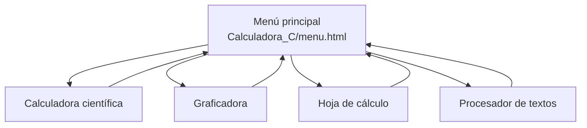
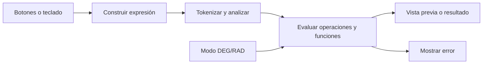
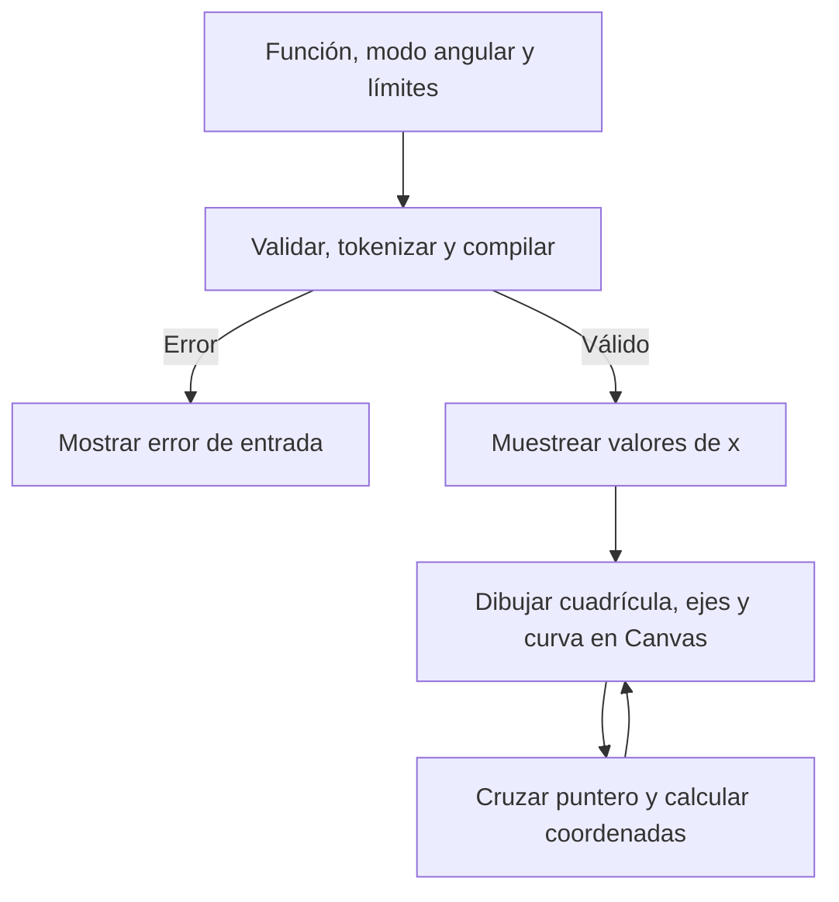
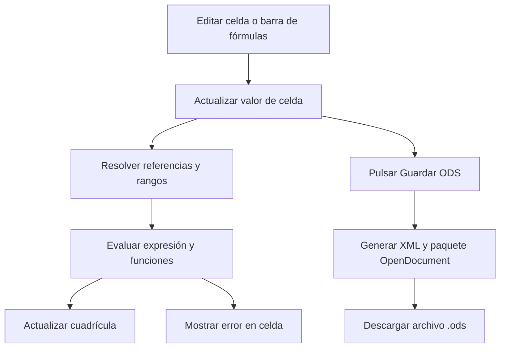
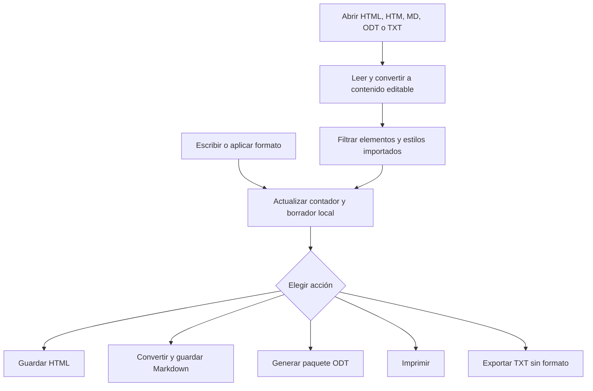

# Aplicaciones web de escritorio

Un conjunto de herramientas ligeras e independientes para cálculos, gráficas, hojas de cálculo y documentos. Están hechas con HTML, CSS y JavaScript nativo, y se ejecutan directamente en un navegador moderno.

> **Sin instalación, servidor, cuenta ni dependencias externas.** Los archivos y borradores se manejan localmente en el navegador; el proyecto no envía datos a un servicio remoto.

## Contenido

- [Comenzar](#comenzar)
- [Aplicaciones](#aplicaciones)
  - [Calculadora científica](#calculadora-científica)
  - [Graficadora](#graficadora)
  - [Hoja de cálculo](#hoja-de-cálculo)
  - [Procesador de textos](#procesador-de-textos)
- [Diagramas](#diagramas)
- [Estructura del proyecto](#estructura-del-proyecto)
- [Detalles técnicos](#detalles-técnicos)
- [Almacenamiento y privacidad](#almacenamiento-y-privacidad)
- [Compatibilidad y límites](#compatibilidad-y-límites)

## Comenzar

1. Descarga el proyecto como ZIP desde GitHub y extrae la carpeta, o clónalo:

   ```bash
   git clone <URL-del-repositorio>
   ```

2. Abre `Calculadora_C/menu.html` en un navegador moderno.
3. Elige la aplicación desde el menú.

No se requiere `npm install`, compilación ni configuración. También puedes abrir directamente cualquiera de los archivos `index.html`. Conserva la estructura de carpetas: las aplicaciones utilizan rutas relativas para cargar sus estilos y volver al menú.

## Aplicaciones

### Calculadora científica

**Carpeta:** [`Calculadora_C/`](Calculadora_C/) · **Entrada:** [`index.html`](Calculadora_C/index.html) · **Menú:** [`menu.html`](Calculadora_C/menu.html)

Calculadora interactiva que evalúa expresiones matemáticas con un analizador implementado en JavaScript.

**Operaciones y funciones**

- Operaciones: suma (`+`), resta (`-`), multiplicación (`*`), división (`/`), potencia (`^`), porcentaje (`%`) y factorial (`!`).
- Admite paréntesis y multiplicación implícita, por ejemplo `2(3+4)`.
- Trigonometría: `sin`, `cos`, `tan`, `asin`, `acos`, `atan`.
- Otras funciones: `sqrt`, `cbrt`, `log` (base 10), `ln` y `abs`.
- Constantes: `pi` y `e`.
- Modo angular seleccionable: grados (`DEG`) o radianes (`RAD`).

**Uso**

- Los botones construyen la expresión y la pantalla presenta una vista previa del resultado.
- `=` o `Enter` calcula; `AC` o `Esc` limpia; `Backspace` elimina el último carácter; `±` cambia el signo.
- También se aceptan desde el teclado números, punto decimal y operadores (`+ - * / ^ % !`).
- Los errores de sintaxis, división por cero, argumentos inválidos y valores fuera de rango se indican en la pantalla.

### Graficadora

**Carpeta:** [`Graficadora/`](Graficadora/) · **Entrada:** [`index.html`](Graficadora/index.html)

Interpreta una función de una variable y la dibuja en un plano interactivo mediante Canvas 2D.

**Sintaxis admitida**

- Variable `x`, constantes `pi` y `e`.
- Operadores `+`, `-`, `*`, `/`, `^`, paréntesis y multiplicación implícita: `2x`, `x(x+1)`.
- Funciones `sin`, `cos`, `tan`, `asin`, `acos`, `atan`, `sqrt`, `cbrt`, `log`, `ln`, `abs` y `exp`.
- DEG/RAD para las funciones trigonométricas.

**Exploración**

- Define los límites mínimo y máximo de los ejes `x` e `y`; los límites deben ser números válidos y cada mínimo debe ser menor que su máximo.
- Utiliza las funciones de ejemplo o restablece los límites iniciales: `x = -10…10` y `y = -5…5`.
- La cuadrícula usa intervalos legibles; al mover el puntero sobre el plano, se muestra una cruz y sus coordenadas.
- Los resultados no finitos o fuera de escala interrumpen el trazo para no conectar a través de discontinuidades.
- Los cambios de función, límites o modo angular vuelven a dibujar el plano.

### Hoja de cálculo

**Carpeta:** [`Hoja_Calculo/`](Hoja_Calculo/) · **Entrada:** [`index.html`](Hoja_Calculo/index.html)

Hoja editable de 8 columnas (`A`–`H`) por 24 filas (`1`–`24`), con una barra de fórmulas y exportación al estándar abierto ODS (OpenDocument Spreadsheet).

**Edición y navegación**

- Selecciona una celda y escribe directamente en ella o usa la barra superior.
- `Enter` confirma y baja una fila; `Shift+Enter` sube una fila.
- `Tab` confirma y avanza una columna; `Shift+Tab` retrocede.
- Las flechas mueven la selección si no hay texto seleccionado para editar.
- El nombre de celda y el resultado se muestran en la barra y en la cuadrícula.

**Fórmulas**

- Comienzan con `=` y admiten números, referencias (`A1`), rangos (`A1:A4`), paréntesis y operadores `+`, `-`, `*`, `/`, `^`.
- Funciones: `SUM`, `PRODUCT`, `AVERAGE` (también `AVG`), `MIN`, `MAX`, `COUNT`, `ABS`, `SQRT`, `ROUND` y `PI`.
- Ejemplos:

  ```text
  =A1+B1
  =SUM(A1:A4)
  =ROUND(AVERAGE(B1:B6),2)
  ```

- Las referencias se calculan al mostrar valores y se resuelven recursivamente. Las referencias circulares y los errores de operación se presentan como mensajes en la celda.

**Exportación**

- El botón **Guardar ODS** descarga `Hoja-de-calculo.ods`, un paquete OpenDocument con `mimetype`, `content.xml` y manifiesto.
- Se escriben valores, texto y fórmulas en el archivo. La aplicación no tiene función para abrir/importar ODS.
- No hay guardado automático local: exporta el ODS para conservar el trabajo.

### Procesador de textos

**Carpeta:** [`Procesador_Textos/`](Procesador_Textos/) · **Entrada:** [`index.html`](Procesador_Textos/index.html)

Editor en navegador con cinta de herramientas y formatos abiertos. El contenido se puede editar, importar, exportar o imprimir.

**Cinta de herramientas**

- **Inicio:** deshacer/rehacer; fuente y tamaño; negrita, cursiva, subrayado, tachado, color de texto y resaltado; tipo de bloque (párrafo, encabezados, cita o código); alineación, listas, sangría y quitar formato.
- **Insertar:** enlaces, tablas, línea horizontal y fecha.
- **Diseño:** ancho y color de página y espaciado de línea.
- Muestra el número de palabras y el formato de guardado activo.
- Atajos globales: `Ctrl+N` para crear, `Ctrl+O` para abrir y `Ctrl+S` para guardar (en macOS también se admite `⌘`). Deshacer y rehacer están disponibles desde los botones de la cinta.

**Archivos**

| Formato | Extensión | Abrir | Guardar | Notas |
|---|---|:---:|:---:|---|
| HTML | `.html`, `.htm` | Sí | Sí | Conserva estructura y estilos admitidos. |
| Markdown | `.md` | Sí | Sí | Sintaxis Markdown común y HTML incrustado para ciertos formatos y colores. |
| OpenDocument Text | `.odt` | Sí | Sí | Documento ODF empaquetado como ZIP, sin biblioteca externa. |
| Texto sin formato | `.txt` | Sí | Sí | Se importa línea por línea; la exportación TXT elimina el formato. |

HTML y ODT son las opciones para conservar mayor fidelidad visual. Markdown mantiene bien la estructura, pero los estilos que se representan con HTML incrustado pueden verse de manera distinta según el visor. Al importar archivos, el editor limita el tamaño a 5 MB y filtra etiquetas, atributos y estilos para aceptar solo un conjunto permitido.

El borrador se guarda automáticamente en el almacenamiento local (`localStorage`) del navegador. Es independiente del archivo descargado; usa **Guardar** para exportar una copia.

## Diagramas

Los diagramas siguientes usan Mermaid, que GitHub renderiza directamente en el README.

### Menú y aplicaciones



### Evaluación en la calculadora



### Flujo de la graficadora



### Celdas, fórmulas y exportación ODS



### Edición, apertura y guardado de documentos



## Estructura del proyecto

```text
.
├── README.md
├── Calculadora_C/
│   ├── menu.html           # Inicio y selección de aplicaciones
│   ├── menu.css            # Diseño del menú
│   ├── index.html          # Calculadora científica
│   ├── styles.css
│   └── script.js
├── Graficadora/
│   ├── index.html
│   ├── styles.css
│   └── script.js
├── Hoja_Calculo/
│   ├── index.html
│   ├── styles.css
│   └── script.js
└── Procesador_Textos/
    ├── index.html
    ├── styles.css
    └── script.js
```

Cada aplicación separa la estructura (HTML), la presentación (CSS) y la interacción y lógica (JavaScript). No existe un proceso de compilación ni un punto de entrada compartido: `Calculadora_C/menu.html` es el lanzador visual, y cada herramienta puede abrirse por separado.

## Detalles técnicos

- **Interfaz:** HTML semántico y CSS independiente por herramienta; las rutas de navegación son relativas.
- **Cálculo:** la calculadora, la graficadora y la hoja tienen tokenizadores y analizadores de expresiones propios. La entrada no se ejecuta como código JavaScript.
- **Gráficas:** Canvas 2D, muestreo de función, ajuste del dispositivo a densidad de píxeles y redibujado al cambiar el tamaño de la vista.
- **Fórmulas de hoja:** referencias resueltas bajo demanda; se detectan ciclos de referencia y se limita a 10 000 el área de un rango evaluado por función.
- **ODF:** las exportaciones ODS y ODT se componen localmente como ZIP con XML y suma de comprobación CRC-32. No se usa un servicio ni una biblioteca de terceros.
- **Importación de documentos:** los archivos ODT se leen como ZIP y se verifica su contenido; la lectura de entradas comprimidas depende de que el navegador soporte `DecompressionStream("deflate-raw")`.
- **Compatibilidad visual:** la interfaz está hecha para navegador moderno. El comando de edición de texto usa `document.execCommand`, que está obsoleto en la plataforma web, aunque sigue disponible en los navegadores habituales; el comportamiento de formato puede variar entre navegadores.

## Almacenamiento y privacidad

- El proyecto no implementa cuentas, backend, sincronización ni telemetría.
- El borrador automático del procesador se almacena en `localStorage` del navegador y permanece en ese perfil hasta que se borre.
- La hoja de cálculo y sus celdas no se persisten al cerrar o recargar la página; descarga un archivo ODS para conservarlos.
- La calculadora y la graficadora no guardan documentos ni historial persistente.
- Las exportaciones se descargan a través del navegador y las importaciones se leen localmente.

## Compatibilidad y límites

- Usa una versión reciente de Chrome, Edge, Firefox o Safari. El comportamiento de edición enriquecida y renderizado de Markdown puede variar entre navegadores y aplicaciones.
- Abre el menú con la estructura del proyecto intacta; no muevas por separado las carpetas de las aplicaciones.
- La hoja actual es una cuadrícula fija de 8 × 24; exporta ODS, pero no importa hojas existentes.
- Markdown no tiene representación estándar para todos los estilos visuales; la fidelidad de colores y detalles depende del visor.
- Algunos ODT comprimidos requieren `DecompressionStream("deflate-raw")`; si el navegador no lo implementa, otros ODT compatibles pueden no abrirse.
- No se declara una licencia de software en este proyecto. Añade un archivo `LICENSE` antes de redistribuirlo bajo una licencia concreta.
