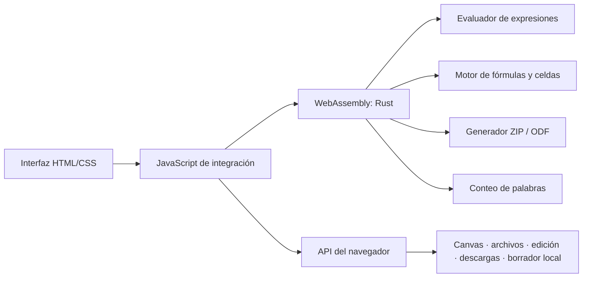

# Aplicaciones WebAssembly

Reingeniería independiente de las cuatro herramientas web del proyecto: calculadora científica, graficadora, hoja de cálculo y procesador de textos. El motor de expresiones, fórmulas, conteo de palabras y empaquetado OpenDocument está escrito en Rust y compilado a WebAssembly. HTML, CSS y una pequeña capa JavaScript proporcionan la interfaz y conectan los controles nativos del navegador con el motor WASM.

> **Esta carpeta es un proyecto aparte.** No reemplaza ni modifica las aplicaciones originales.

## Inicio rápido

Se incluye el módulo compilado en `pkg/aplicaciones_wasm.wasm`; para probarlo no hace falta instalar Rust.

1. Inicia un servidor HTTP local desde esta carpeta:

   ```bash
   python3 -m http.server 8000
   ```

2. Abre <http://localhost:8000> en un navegador compatible.
3. Escoge una de las cuatro herramientas.

No abras `index.html` con una URL `file://`: por seguridad, los navegadores normalmente impiden que `fetch()` cargue el módulo WASM local. No se requiere conexión a internet para utilizar la aplicación después de descargar este proyecto.

## Compilar el motor

Requisitos de compilación: Rust 1.85 o posterior y Cargo; el target WASM se instala una sola vez:

```bash
rustup target add wasm32-unknown-unknown
./build.sh
```

El script compila el crate sin dependencias externas y copia el artefacto a `pkg/aplicaciones_wasm.wasm`.

Para validar la lógica en el host:

```bash
cargo test
```

## Herramientas

### Calculadora científica

- Operaciones `+`, `-`, `*`, `/`, potencia `^`, porcentaje y factorial.
- Paréntesis y multiplicación implícita como `2(3+4)`.
- Trigonometría: `sin`, `cos`, `tan`, `asin`, `acos`, `atan`.
- Funciones `sqrt`, `cbrt`, `log` (base 10), `ln` y `abs`; constantes `pi` y `e`.
- Modos angulares DEG/RAD, vista previa, botones, teclado, borrado y mensajes de error.

### Graficadora

- Grafica expresiones de `x` con operaciones, paréntesis y multiplicación implícita.
- Funciones `sin`, `cos`, `tan`, `asin`, `acos`, `atan`, `sqrt`, `cbrt`, `log`, `ln`, `abs`, `exp`; constantes `pi` y `e`.
- Configuración de límites `x`/`y`, modos DEG/RAD, ejemplos, cuadrícula y coordenadas bajo el puntero.
- Las discontinuidades y resultados que no son finitos interrumpen el trazo.

### Hoja de cálculo

- Cuadrícula editable de 8 columnas por 24 filas.
- Fórmulas con números, referencias, rangos, paréntesis y operaciones aritméticas.
- Funciones `SUM`, `PRODUCT`, `AVERAGE`/`AVG`, `MIN`, `MAX`, `COUNT`, `ABS`, `SQRT`, `ROUND` y `PI`.
- Detección de referencias circulares y errores de fórmula.
- Exportación ODS/OpenDocument generada por el motor WASM, sin biblioteca de terceros.
- No tiene importación ODS ni persistencia automática; descarga el archivo ODS para guardar la hoja.

### Procesador de textos

- Editor enriquecido en el navegador con fuente y tamaño, negrita, cursiva, subrayado, tachado, títulos, citas, listas, alineación, colores, enlaces, tablas, fecha e impresión.
- Ajustes de ancho de página, color e interlineado; deshacer/rehacer y creación de documentos.
- Recuento de palabras ejecutado en Rust/WebAssembly y borrador local en el almacenamiento del navegador.
- Guarda HTML, Markdown (`.md`), ODT (ODF Text) y TXT; puede abrir HTML, HTM, MD, ODT y TXT.
- HTML se limpia con una lista permitida de etiquetas, atributos y estilos; la importación está limitada a 5 MB.
- ODT se empaqueta desde WebAssembly. Conserva párrafos, títulos, listas, tablas y estilos de texto sencillos. La apariencia más elaborada puede cambiar entre formatos.
- Markdown conserva estructura común. Colores y otros estilos no forman parte del estándar Markdown y no se garantizan en visores externos.
- La importación limita el archivo a 5 MB y las entradas descomprimidas a 20 MB, y comprueba su tamaño y CRC. ODT comprimidos con DEFLATE requieren `DecompressionStream("deflate-raw")`.

## Arquitectura



El límite de interoperabilidad se implementa con una ABI C mínima: JavaScript reserva memoria lineal, copia cadenas UTF-8 y llama a funciones exportadas por el módulo. No se utiliza `wasm-bindgen`, `wasm-pack` ni paquetes de JavaScript. El parser evalúa expresiones permitidas en lugar de ejecutar texto como código JavaScript.

### Organización

```text
reingenieria/
├── Cargo.toml
├── build.sh
├── index.html
├── styles.css
├── app.js
├── src/
│   └── lib.rs
└── pkg/
    └── aplicaciones_wasm.wasm
```

## Compatibilidad

El objetivo es WebAssembly MVP (`wasm32-unknown-unknown`) y navegadores comerciales actuales que implementan WebAssembly y las APIs web utilizadas: versiones vigentes de Chrome, Edge, Firefox y Safari. **No es posible garantizar compatibilidad con todas las versiones pasadas, presentes o futuras** de todos los navegadores; versiones antiguas pueden carecer de funciones modernas de JavaScript, `ResizeObserver` o `DecompressionStream`.

La interfaz permanece en HTML/CSS/JavaScript porque WebAssembly no sustituye las APIs de interfaz del navegador. La graficadora utiliza Canvas 2D; el procesador usa edición enriquecida del navegador, cuyo soporte y comportamiento de formato puede variar. No hay backend ni sincronización en la nube.

## Privacidad y almacenamiento

- Los cálculos y fórmulas se realizan localmente en el módulo WebAssembly.
- No se envían documentos, fórmulas ni datos de celdas a servicios externos.
- El procesador conserva un borrador en `localStorage`; el resto de herramientas mantiene sus datos solo durante la sesión.
- Las descargas de HTML, Markdown, TXT, ODT y ODS las gestiona el navegador.

## Licencia

Consulta [`LICENSE`](LICENSE). El módulo WASM y la aplicación incluidos en esta carpeta se distribuyen bajo MIT.
